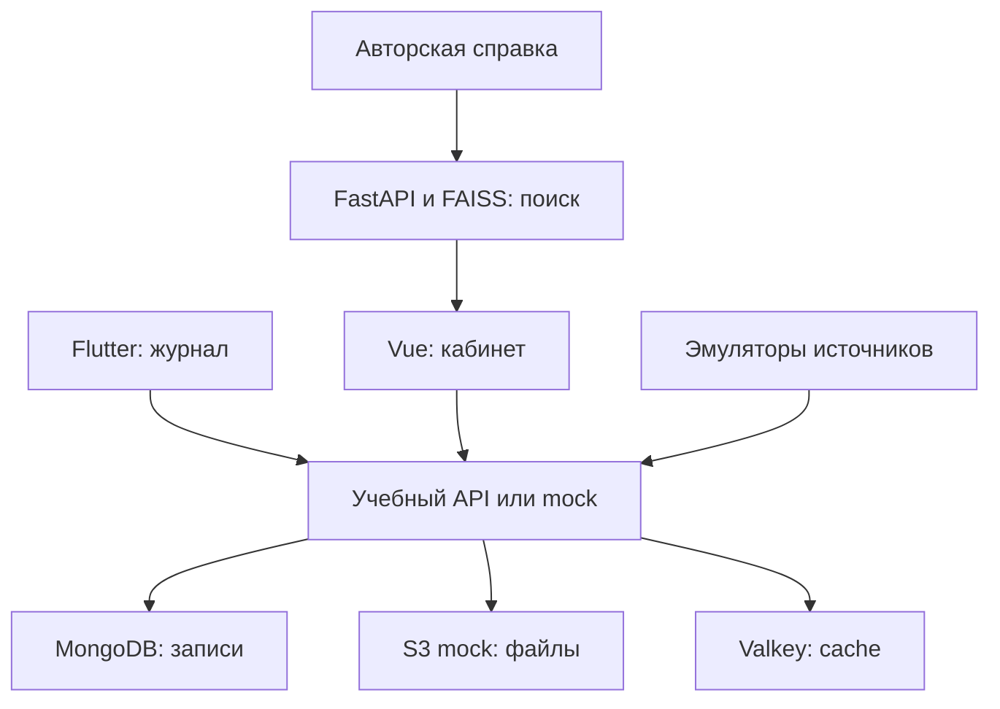

# Как связаны учебные компоненты

Это схема PulseLab, а не рабочей инфраструктуры TeleMedHub. На каждом направлении нужные соседи заменяются локальными fake/mock: студент не ждёт реализации другого участника.

| Граница | Что студент должен уметь объяснить |
| --- | --- |
| UI → API | Контракт, loading/error/empty, отмена старого запроса |
| Источник → адаптер | Поля, единицы, время, версия и неизвестные значения |
| API → repository | Валидация, права на субъект, атомарная уникальность |
| Repository → cache | Какие данные кешируются, границы доступа, инвалидизация |
| Файлы → metadata | Что происходит при частичном сбое и кто разрешает чтение |
| Справка → индекс → ответ | Происхождение chunk, версия индекса и проверяемая citation |
| Процесс → инфраструктура | Readiness, shutdown, persistence, восстановление |

Мини-пример анализа требований: «Список должен показывать только записи выбранного субъекта». Уточнить: кто запрашивает; какие субъекты ему доступны; как задаются фильтры; что делать при неизвестном subjectId; что показывать при пустом результате; как проверить запрет прямым запросом. В каждом отчёте полезно назвать хотя бы одно такое уточнение и связать его с тестом.
